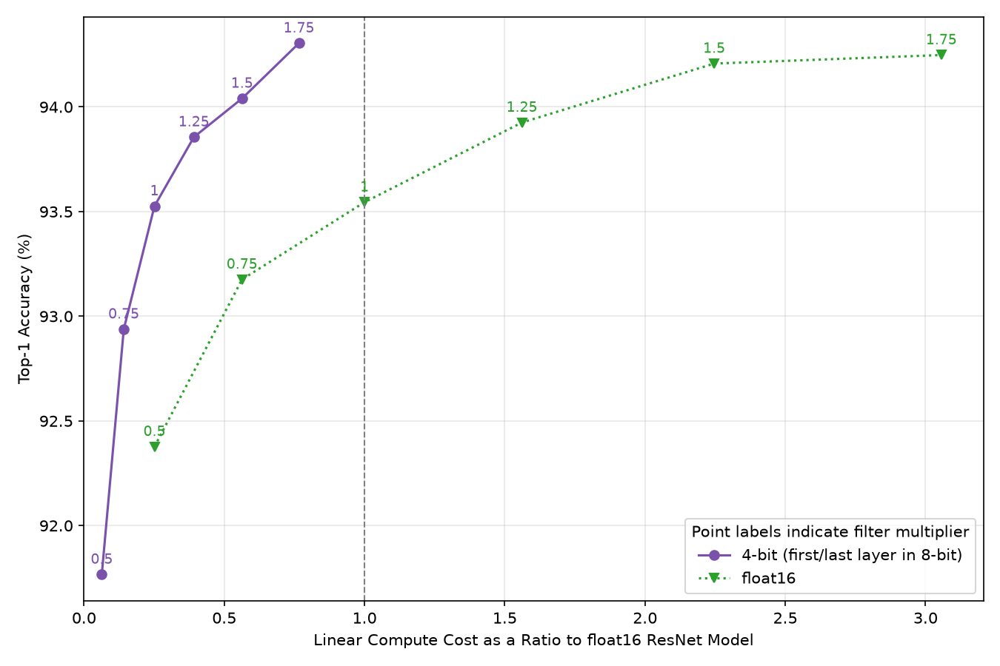

# Tinygrad implementation of "Pareto-Optimal Quantized ResNet Is Mostly 4-bit"

A tinygrad implementation of the recipe outlined in [Pareto-Optimal Quantized ResNet Is Mostly 4-bit](https://arxiv.org/abs/2105.03536) for a fast CIFAR-10 model. 

The model is based off the [`cifar10-fast`](https://github.com/davidcpage/cifar10-fast) model and training recipe but deviates in a few ways (no PCA init, ReLU activations, no TTA). On a 7900XTX, this code will train the base config (scale = 1.0) half precision model to ~93.5% accuracy in 72 seconds.

We use the following recipe from the paper:
- 8 bit WA quantization for first and last layers
- 4 bit WA quantization for all internal layers
- Fake quantization (quant -> dequant -> compute)
- Unsigned quantization on all internal activations following a ReLU
- Activation quantization enabled after 20% of the training steps

Even on a different dataset and model the paper's recipe still transfers:



## Installation
Requires `uv`

```bash
git clone https://github.com/fattorib/4bit-resnet.git && cd 4bit-resnet
uv sync
wandb login
```

## Training
*Tested on 7900XTX with a chestnut eGPU dock*

The following `tinygrad` flags are required for best performance
```
WINO=1 JITBEAM=1
```

Run the unquantized recipe with channel scale of 1.25 across 5 trials:
```bash
SCALE=1.25 TRIALS=5 QUANTIZED=0 WINO=1 JITBEAM=1 DEV=USB+AMD uv run train.py
```

Run the quantized recipe with channel scale of 1.0 across 5 trials:
```bash
SCALE=1.0 TRIALS=5 QUANTIZED=1 WINO=1 JITBEAM=1 DEV=USB+AMD uv run train.py
```
